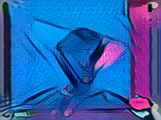
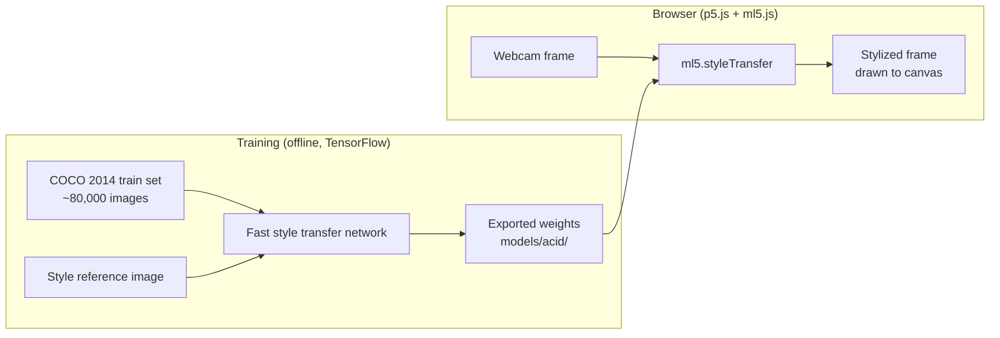

<h1 align="center">Live Style Transfer</h1>

<p align="center">
  <b>Real-time neural style transfer on a live webcam feed, running in the browser</b><br>
  CS351 Artificial Intelligence · GIK Institute of Engineering Sciences &amp; Technology · 2022
</p>

<p align="center">
  
  
  
</p>

<p align="center">
  <a href="docs/Project-Report.pdf"><b>📄 Project report</b></a>
</p>

---

> [!NOTE]
> This is a coursework project from my undergraduate studies (BS Computer Science, GIKI). I'm posting it to GitHub retroactively, for the record.

## Overview

This project takes the "style" of a reference artwork and repaints every frame of a live webcam feed with it, in real time, inside a web page. It is a proof of concept: a hands-on look at what generative models could do with video at the time, and where they fall short.

<p align="center">
  <br>
  <sub>A webcam frame after style transfer.</sub>
</p>

## How it works



1. **Training.** A feed-forward transformation network learns to restyle any photo in a single pass, trained on the COCO 2014 training images against one style image. The implementation is a variant of Logan Engstrom's TensorFlow *fast-style-transfer*. It follows Johnson et al.'s perceptual-loss approach but uses Ulyanov's **instance normalization** instead of batch normalization, with a slightly different scale/offset layer and shallower style layers (`relu1_1`).
2. **Export.** The trained checkpoint is exported as raw weight files plus a `manifest.json`, the format ml5.js loads in the browser.
3. **Inference.** `js/sketch.js` captures the webcam with p5.js and hands each frame to `ml5.styleTransfer`. When a stylized frame comes back it is drawn to the canvas and the next frame is sent straight away, so the loop runs as fast as the device allows.

## Results

- The model works best with **visually busy style images**: high contrast and plenty of color variation.
- **Artifacts** are the main open issue. Quality depends heavily on the style image, especially its color variation and the typical size of the shapes in it.
- Normalization and the offset layer reduce the frame-to-frame **flicker** that per-frame stylization would otherwise produce.

## Running it

The page has to be served over HTTP (browsers only allow webcam access on `localhost` or HTTPS):

```bash
cd live-style-transfer
python -m http.server 8000
```

Then open <http://localhost:8000> and allow camera access. The status line changes to **Model Loaded** once the weights are in, and the stylized feed appears below it.

> [!NOTE]
> The original style reference image was a third-party illustration, so it isn't included here. The page expects an image at `images/acid.jpg` for its overview panel. Drop in any image you like; the model itself doesn't need it.

## Team

**Asad Shahab** · Shams Ghani · Khuzaima Abbasi

## References

1. L. A. Gatys, A. S. Ecker, M. Bethge. *A Neural Algorithm of Artistic Style.* 2015. [arXiv:1508.06576](https://arxiv.org/abs/1508.06576)
2. J. Johnson, A. Alahi, L. Fei-Fei. *Perceptual Losses for Real-Time Style Transfer and Super-Resolution.* ECCV 2016. [Project page](https://cs.stanford.edu/people/jcjohns/eccv16/)
3. D. Ulyanov, A. Vedaldi, V. Lempitsky. *Instance Normalization: The Missing Ingredient for Fast Stylization.* 2016. [arXiv:1607.08022](https://arxiv.org/abs/1607.08022)
4. M. Ruder, A. Dosovitskiy, T. Brox. *Artistic Style Transfer for Videos.* 2016. [arXiv:1604.08610](https://arxiv.org/abs/1604.08610)
5. L. Engstrom. *fast-style-transfer* (TensorFlow). [GitHub](https://github.com/lengstrom/fast-style-transfer)
6. R. Nakano. *fast-style-transfer-deeplearnjs.* [GitHub](https://github.com/reiinakano/fast-style-transfer-deeplearnjs)
7. Page layout based on a free [TemplateMo](https://templatemo.com/) template.
